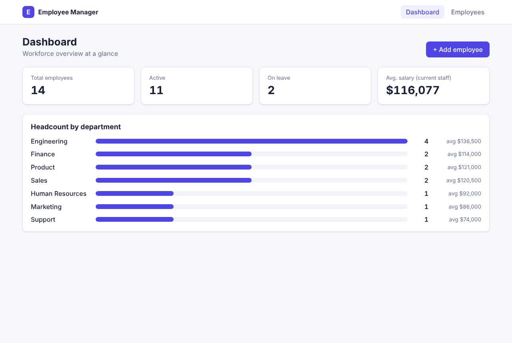
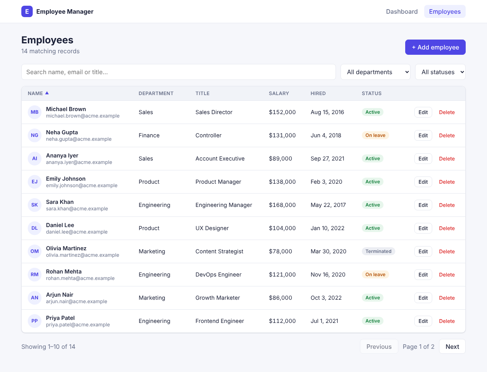
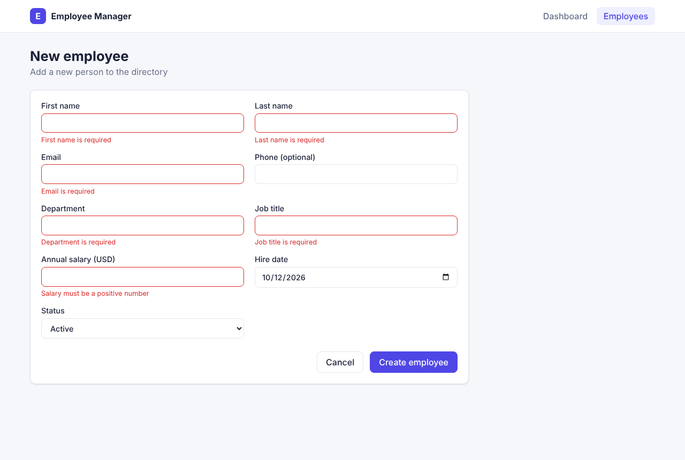
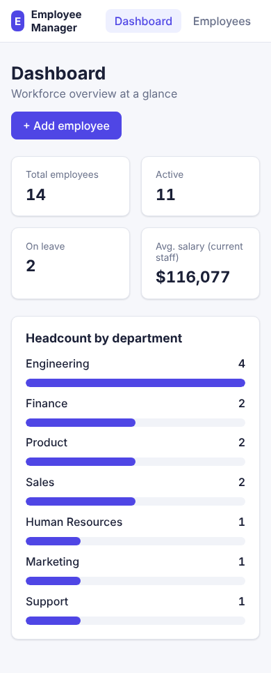

# Employee Management System

A full-stack web application for managing employee records — a **Spring Boot REST API** with a **React + TypeScript** single-page frontend.



## Features

- **Dashboard** with headcount by status, average salary, and a per-department breakdown
- **Employee directory** with debounced search, department/status filters, sortable columns and server-side pagination (filters are stored in the URL, so views are shareable)
- **Create / edit / delete** employees with client-side and server-side validation, duplicate-email detection and a delete confirmation dialog
- **Consistent API errors** using RFC 7807 Problem Details, with per-field validation messages shown inline in the form
- **Interactive API docs** via Swagger UI
- Responsive layout with automatic dark mode

## Tech stack

| Layer    | Technology |
|----------|------------|
| Backend  | Java 21, Spring Boot 3.5, Spring Data JPA (Specifications), Bean Validation, springdoc-openapi |
| Database | H2 (in-memory, zero-setup dev) / MySQL 8 (`mysql` profile, Docker) |
| Frontend | React 19, TypeScript, Vite, React Router |
| Testing  | JUnit 5, Mockito, MockMvc integration tests · Vitest, React Testing Library |
| DevOps   | Docker, Docker Compose, Nginx, GitHub Actions CI |

## Architecture

```
React SPA (Vite / Nginx)  ──/api──▶  Spring Boot REST API  ──JPA──▶  H2 / MySQL
  pages · components · api client      controller → service → repository
```

```
employee-management/
├── backend/                      Spring Boot API
│   └── src/main/java/com/example/employees/
│       ├── controller/           REST endpoints
│       ├── service/              business logic & validation rules
│       ├── repository/           JPA repository + dynamic search specifications
│       ├── entity/               JPA entities
│       ├── dto/                  request/response records
│       ├── exception/            global exception handler (Problem Details)
│       └── config/               CORS, sample-data seeder
├── frontend/                     React + TypeScript SPA
│   └── src/  api/ · components/ · pages/
└── docker-compose.yml            MySQL + backend + frontend
```

## Getting started

### Option 1 — run locally (no database needed)

Prerequisites: Java 21, Maven, Node.js 20+.

```bash
# Terminal 1 — backend on http://localhost:8080 (in-memory H2, seeded with sample data)
cd backend
mvn spring-boot:run

# Terminal 2 — frontend on http://localhost:5173 (proxies /api to the backend)
cd frontend
npm install
npm run dev
```

- App: http://localhost:5173
- Swagger UI: http://localhost:8080/swagger-ui.html
- H2 console: http://localhost:8080/h2-console (JDBC URL `jdbc:h2:mem:employees`, user `sa`)

To use a local MySQL instead: `mvn spring-boot:run -Dspring-boot.run.profiles=mysql` with `DB_URL`, `DB_USERNAME`, `DB_PASSWORD` set as needed.

### Option 2 — Docker Compose (MySQL + backend + frontend)

```bash
docker compose up --build
```

App at http://localhost:3000, API at http://localhost:8080.

## REST API

| Method | Endpoint | Description |
|--------|----------|-------------|
| GET    | `/api/employees` | Search/list. Query params: `search`, `department`, `status`, `page`, `size`, `sortBy`, `direction` |
| GET    | `/api/employees/{id}` | Get one employee |
| POST   | `/api/employees` | Create (201 + `Location` header) |
| PUT    | `/api/employees/{id}` | Update |
| DELETE | `/api/employees/{id}` | Delete (204) |
| GET    | `/api/employees/stats` | Dashboard statistics |
| GET    | `/api/employees/departments` | Distinct department names |

Example error response:

```json
{
  "type": "about:blank",
  "title": "Validation Failed",
  "status": 400,
  "detail": "One or more fields are invalid",
  "errors": { "email": "must be a well-formed email address" }
}
```

## Running tests

```bash
cd backend && mvn test            # service unit tests + full HTTP integration tests
cd frontend && npm test           # form validation & component tests
cd frontend && npm run lint
```

## Screenshots

| Employees | Form validation | Mobile |
|-----------|-----------------|--------|
|  |  |  |

## Possible next steps

- Authentication & role-based access (Spring Security + JWT)
- Flyway database migrations
- CSV export / bulk import
- Deploy (e.g. Render/Railway for the API, Vercel/Netlify for the frontend)
